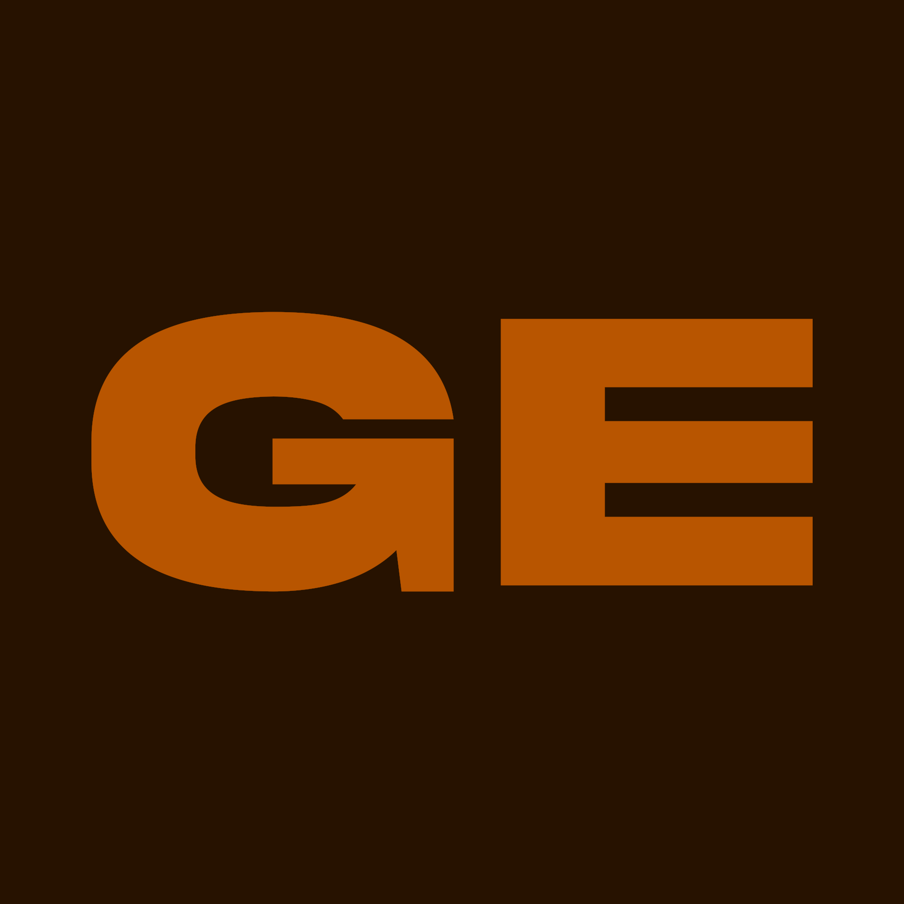
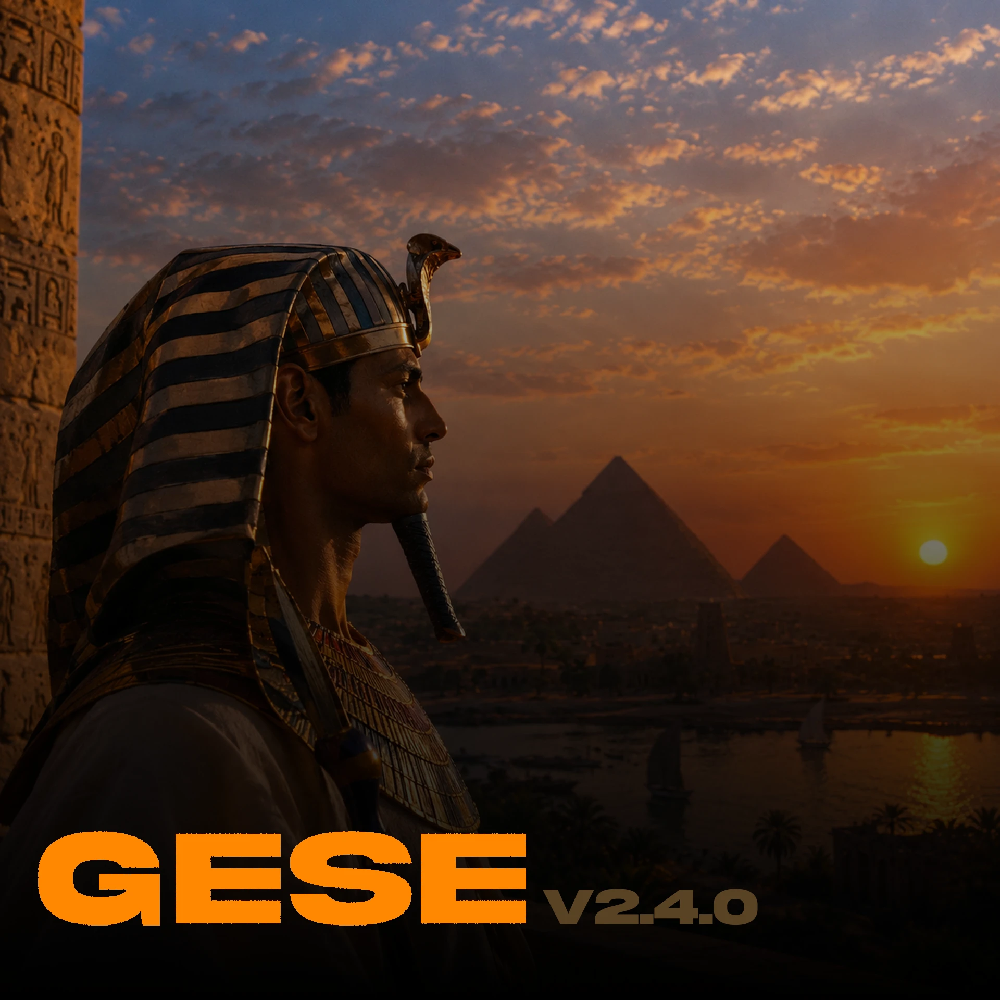

<p align="center">
  
</p>

<h1 align="center">GeSe</h1>

<p align="center">
  <b>A motion graphics and video editor for Windows, written from scratch in C++.</b><br>
  Layers, keyframes, curves, 3D with cameras and lights, 218 GPU effects, voice tools and built-in AI background removal.
</p>

<p align="center">
  
  
  
  
  
</p>

<p align="center">
  
</p>

---

## Highlights

| | |
|---|---|
| **Compositing** | Unlimited layers and nested compositions (compound clips you can unpack again), 25 blend modes, track mattes, masks with feather, parenting, null objects, effect layers. |
| **Animation** | Keyframes on every property, keyframes shown right on the clips, a **Graph Editor** with 13 ready-made curves (ease, back, bounce, elastic…), your own cubic-bezier curves and saved curve presets. |
| **3D** | 3D layers with depth and X/Y/Z rotation, cameras (zoom, lens presets, point of interest, depth of field) and lights (point, spot, parallel, ambient) with material options. |
| **Effects** | 218 effects in 15 categories, all on the GPU in 16-bit float: color grading, blur, distortion, glitch, light & lens, keying, transitions, generators… Every effect has keyframable intensity; animated ones have speed. Hold the pointer on an effect to preview it in the viewer. |
| **Plugins** | Effects are plain-text `.gsfx` files (an HLSL function plus a parameter header). Drop new ones into `plugins\` — no compiler needed. |
| **Motion blur** | Blur, blend, direction (both / behind / ahead) and number of copies, for layer movement *and* for the motion inside the video (frame blending). |
| **Audio & voice** | Slow down or speed up a clip with or without changing the pitch, pitch shift on its own, 15 voice effects (deep, chipmunk, robot, echo, telephone…), noise reduction, voice enhance, fades, normalize, extract audio to its own layer, save clip audio as WAV / MP3 / M4A / FLAC. |
| **AI background removal** | Built-in BiRefNet network running locally through ONNX Runtime + DirectML: free, offline, no limits, ~0.3 s per 1080p frame on a modern GPU (CPU fallback). Cloud services can be used too. |
| **Timeline** | Magnet snapping with a guide that shows what a clip stuck to, rubber-band selection, ripple delete, split, freeze frame, speed / reverse, markers, work area, ← → frame stepping. |
| **Canvas** | Background color with ready swatches, a blurred copy of the video, or an image. Full-screen preview (F11). |
| **Media** | Thumbnail media browser with folders; import files, whole folders or ZIP archives. Image sequences, video, stills and audio through FFmpeg. |
| **Export** | H.264 / H.265 (NVENC, AMF, Quick Sync or x264), ProRes 422 HQ / 4444 with alpha, VP9 with alpha, PNG sequences, audio-only. Render queue with presets. |
| **Interface** | Dockable panels and workspaces, five languages (English, Русский, Українська, Deutsch, Español), undo/redo for everything, autosave. |

## Download

Grab `GeSe_Setup.exe` from the [Releases](../../releases) page. The installer is per-user (no administrator rights), adds shortcuts and `.gese` / `.gsfx` file associations, and can be removed from *Settings → Apps*.

**Requirements:** Windows 10 or 11 (64-bit), a Direct3D 11 GPU. The AI tools use any DirectX 12 GPU when available.

## Building from source

GeSe builds with MinGW-w64 GCC (C++20), CMake and Ninja.

```powershell
# 1. third-party binaries that are not stored in git (FFmpeg, ONNX Runtime, DirectML, the AI model)
powershell -ExecutionPolicy Bypass -File tools\fetch_deps.ps1

# 2. build (toolchain from -Toolchain, %GESE_MINGW% or PATH)
powershell -ExecutionPolicy Bypass -File tools\build.ps1 -Toolchain C:\mingw64

# 3. optional: the single-file installer (build\bin\GeSe_Setup.exe)
powershell -ExecutionPolicy Bypass -File tools\build.ps1 -Installer
```

Checks:

```powershell
build\bin\GeSe.exe --check-effects                 # compiles every effect
build\bin\GeSe.exe --selftest test\test.mp4 out    # render, export, audio, 3D, AI, undo
```

## Program layout

```
GeSe.exe            the editor
runtime\            DLLs (FFmpeg, ONNX Runtime, DirectML, VC++ runtime)
resources\          effects, fonts, splash, presets, AI model
plugins\            your .gsfx effects
licenses\           third-party notices
```

## Writing an effect

```hlsl
@effect Soft Vignette
@id my.softvignette
@category Light & Lens
@param float amount "Amount" 50 0 100 %
@code
float4 effect(float2 uv) {
    float4 c = SRC(uv);
    float d = length(uv - 0.5) * 1.4;
    c.rgb *= 1.0 - smoothstep(0.4, 1.0, d) * amount / 100.0 * INTENSITY;
    return c;
}
@end
```

Save it as `plugins\SoftVignette.gsfx` and it appears in *Effects & Presets*. See *Help → Plugin SDK* inside the app for every directive and built-in function.

## Source layout

| Path | What |
|---|---|
| `src/` | the editor: UI panels, renderer, project model, media, audio, export, AI |
| `installer/` | the setup program (embeds an LZMS-compressed payload) |
| `Main/` | built-in effects, presets, fonts and artwork (copied to `resources\`) |
| `third_party/imgui` | Dear ImGui (docking branch, with small patches) |
| `tools/` | build, dependency and packaging scripts |

## Third-party software

FFmpeg (GPL build, including Rubber Band, x264, libvpx and LAME), ONNX Runtime and DirectML (Microsoft, MIT / redistributable), the BiRefNet model (MIT), Dear ImGui (MIT). Details are in [`licenses/THIRD-PARTY-NOTICES.txt`](licenses/THIRD-PARTY-NOTICES.txt).

## License

GeSe is free software, released under the **GNU General Public License v3.0** — see [LICENSE](LICENSE).
You may use, study, share and change it; modified versions you distribute must stay under the same license.
